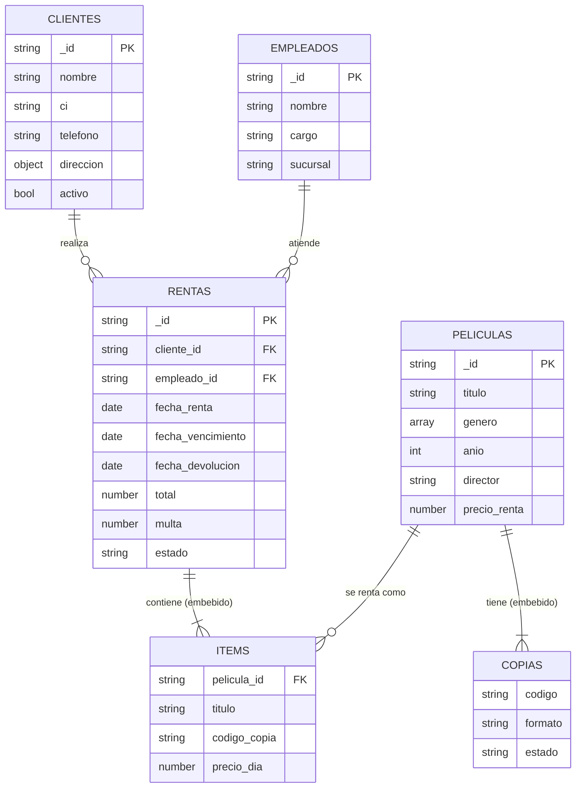

Alvaro Marvin Fabian Chuquimia(Alvinich)
Cristian Josue Cori Copa (josuecoricopa)
Gabriel Adalid Mendoza Flores(RealMandril)
Pablo Sebastian Alcoreza Mamani(Sebas69710)


# 🎬 Renta de videos — Implementación en MongoDB

**Universidad Privada Franz Tamayo** · Ingeniería de Sistemas e Innovación Digital
**Autor:** _[Tu nombre completo]_ · **Fecha:** noviembre de 2026

Implementación completa en **MongoDB** del problema *Renta de videos*: una tienda que presta copias físicas de películas a sus clientes por días, cobra el alquiler y aplica multas por devolución tardía.

El repositorio contiene scripts JavaScript (para `mongosh`) que **crean** la base de datos, la **llenan** con datos de ejemplo y permiten **consultarla y modificarla**.

---

## 1. Modelo de datos

La base de datos se llama `renta_videos` y tiene 4 colecciones.

| Colección   | Qué guarda                                                        | Decisión de diseño |
|-------------|-------------------------------------------------------------------|--------------------|
| `clientes`  | Datos personales y dirección de cada cliente                      | La dirección va **embebida** (siempre se consulta junto al cliente). |
| `empleados` | Personal que atiende en las sucursales                            | Colección pequeña, referenciada desde `rentas`. |
| `peliculas` | Ficha de la película y sus **copias físicas** (`copias[]`)        | Las copias van **embebidas**: son pocas por película y se consultan juntas para saber la disponibilidad. |
| `rentas`    | Cada alquiler, con las copias rentadas (`items[]`), total y multa | Los `items` van **embebidos** y guardan una copia del título y del precio vigente al momento de la renta (el historial no cambia si luego sube el precio). Cliente y empleado se **referencian** por `_id`. |



### Reglas del negocio usadas

- El **total** de una renta = suma del precio por día de cada copia × número de días.
- La **multa** = Bs 2 por copia y por día de retraso (solo si se devuelve después de `fecha_vencimiento`).
- Una copia tiene estado `disponible`, `rentada` o `danada`.
- Los `_id` son códigos legibles (`cli-001`, `pel-001`, `ren-001`…) para que las referencias se entiendan a simple vista.

### Ejemplo de documentos

<details>
<summary>Película con sus copias</summary>

```json
{
  "_id": "pel-001",
  "titulo": "El Padrino",
  "genero": ["Drama", "Crimen"],
  "anio": 1972,
  "director": "Francis Ford Coppola",
  "actores": ["Marlon Brando", "Al Pacino"],
  "duracion_min": 175,
  "clasificacion": "+16",
  "precio_renta": 6,
  "copias": [
    { "codigo": "PEL001-A", "formato": "DVD",     "estado": "disponible" },
    { "codigo": "PEL001-B", "formato": "DVD",     "estado": "rentada" },
    { "codigo": "PEL001-C", "formato": "Blu-ray", "estado": "disponible" }
  ]
}
```
</details>

<details>
<summary>Renta con sus items</summary>

```json
{
  "_id": "ren-004",
  "cliente_id": "cli-001",
  "empleado_id": "emp-01",
  "fecha_renta": "2026-09-02T00:00:00.000Z",
  "dias": 3,
  "fecha_vencimiento": "2026-09-05T00:00:00.000Z",
  "fecha_devolucion": "2026-09-05T00:00:00.000Z",
  "items": [
    { "pelicula_id": "pel-001", "titulo": "El Padrino",   "codigo_copia": "PEL001-A", "precio_dia": 6 },
    { "pelicula_id": "pel-011", "titulo": "Interestelar", "codigo_copia": "PEL011-A", "precio_dia": 8 }
  ],
  "total": 42,
  "multa": 0,
  "estado": "devuelta"
}
```
</details>

### Validaciones e índices

- **Validación de esquema** (`$jsonSchema`, nivel `strict`, acción `error`) en las 4 colecciones: campos obligatorios, tipos, valores permitidos (`enum`), CI de 6 a 10 dígitos, celular boliviano de 8 dígitos que empieza con 6 o 7, correo con formato válido, etc.
- **Índices:** CI único en clientes, índice de texto (título y director) y código de copia único en películas, e índices por cliente/fecha, estado/vencimiento y película en rentas.

---

## 2. Estructura del repositorio

```
renta-videos-mongodb/
├── README.md
├── docker-compose.yml          # MongoDB 7 con los scripts montados en /scripts
├── ejecutar_todo.sh            # Ejecuta los 4 scripts en orden
├── scripts/
│   ├── 01_crear.js             # Base de datos, colecciones, validaciones e índices
│   ├── 02_llenar.js            # Inserción de empleados, clientes, películas y rentas
│   ├── 03_consultas.js         # 13 consultas (find y aggregate)
│   └── 04_actualizar_eliminar.js  # Insertar, actualizar, eliminar y probar validaciones
└── docs/img/                   # Capturas de pantalla usadas en este README
```

---

## 3. Pasos para implementar la base de datos

### Requisitos

- **MongoDB 5.0 o superior** (se usa el operador `$dateDiff`). Los scripts se escribieron para MongoDB 7.
- **mongosh** (la consola de MongoDB). Si usas Docker, ya viene dentro del contenedor.
- Opcional: [MongoDB Compass](https://www.mongodb.com/products/tools/compass) para ver los documentos con interfaz gráfica.

### Paso 1 — Clonar el repositorio

```bash
git clone <URL-DE-TU-REPOSITORIO>
cd renta-videos-mongodb
```

### Paso 2 — Tener un MongoDB en ejecución

**Opción A: con Docker (recomendada)**

```bash
docker compose up -d
```

**Opción B: MongoDB instalado en tu computadora**

Inicia el servicio `mongod` y verifica que acepta conexiones en `mongodb://localhost:27017`.

### Paso 3 — Ejecutar los scripts en orden

**Con mongosh instalado:**

```bash
mongosh "mongodb://localhost:27017" --file scripts/01_crear.js
mongosh "mongodb://localhost:27017" --file scripts/02_llenar.js
mongosh "mongodb://localhost:27017" --file scripts/03_consultas.js
mongosh "mongodb://localhost:27017" --file scripts/04_actualizar_eliminar.js
```

(o todo de una vez en Linux/macOS: `./ejecutar_todo.sh`)

**Con Docker (sin instalar mongosh):**

```bash
docker compose exec mongo mongosh --quiet --file /scripts/01_crear.js
docker compose exec mongo mongosh --quiet --file /scripts/02_llenar.js
docker compose exec mongo mongosh --quiet --file /scripts/03_consultas.js
docker compose exec mongo mongosh --quiet --file /scripts/04_actualizar_eliminar.js
```

### Paso 4 — Verificar manualmente

```bash
mongosh "mongodb://localhost:27017/renta_videos"
```

```js
show collections
db.peliculas.countDocuments()
db.rentas.findOne({ estado: "activa" })
```

### Volver a empezar

`01_crear.js` elimina y vuelve a crear la base de datos, así que para restaurar los datos originales (por ejemplo, después de ejecutar `04`) basta con repetir los pasos `01` y `02`.

---

## 4. Evidencia de ejecución (capturas de pantalla)

> Todas las capturas muestran la terminal con `mongosh` (o Compass donde se indica). Si la salida es larga, se muestra la parte inicial.

### 4.1 MongoDB en ejecución


**Qué se muestra:** el contenedor `renta-videos-mongo` levantado con `docker compose up -d` (o el servicio local), y la conexión exitosa con `mongosh` al servidor en `localhost:27017`.

### 4.2 Creación de la base de datos, colecciones e índices — `01_crear.js`


**Qué se muestra:** la ejecución de `01_crear.js`. Aparecen las 4 colecciones creadas (`clientes`, `empleados`, `peliculas`, `rentas`) y, debajo de cada una, los índices generados (`uq_clientes_ci`, `txt_titulo_director`, `uq_copias_codigo`, `ix_rentas_estado_vencimiento`, etc.).

### 4.3 Reglas de validación del esquema


**Qué se muestra:** el resultado de `db.getCollectionInfos({ name: "clientes" })` dentro de `renta_videos`, donde se ve el `$jsonSchema` con los campos obligatorios y los patrones de `ci` y `telefono`.

### 4.4 Llenado de la base de datos — `02_llenar.js`


**Qué se muestra:** los mensajes de inserción (3 empleados, 8 clientes, 12 películas y 14 rentas), el conteo de documentos por colección y un ejemplo de documento de `peliculas` (con su arreglo `copias`) y de `rentas` (con su arreglo `items`).

### 4.5 Consultas simples — `03_consultas.js` (C1 a C4)


**Qué se muestra:** el catálogo ordenado por año (C1), las películas de animación de hasta 5 Bs por día (C2), la búsqueda de texto "futuro padrino" que encuentra *Volver al Futuro* y *El Padrino* usando el índice de texto (C3) y los clientes activos de La Paz (C4).

### 4.6 Disponibilidad y rentas — `03_consultas.js` (C5 a C8)


**Qué se muestra:** copias disponibles por película (C5), rentas activas con el nombre del cliente obtenido con `$lookup` (C6), rentas vencidas con los días de atraso y la multa estimada (C7: `ren-011` con 6 días y `ren-014` con 3 días) y el historial de rentas del cliente `cli-001` (C8).

### 4.7 Estadísticas con agregaciones — `03_consultas.js` (C9 a C13)


**Qué se muestra:** las películas más rentadas (C9), los ingresos por mes (C10), los 3 mejores clientes (C11), los géneros más rentados (C12) y los clientes que nunca han rentado (C13: `cli-007` y `cli-008`).

### 4.8 Registrar, devolver, actualizar y eliminar — `04_actualizar_eliminar.js`


**Qué se muestra:** el registro de una renta nueva (`ren-015`) y el cambio de la copia a `rentada` (U1); la devolución de `ren-011` con su multa de 12 Bs por 6 días de atraso y la copia que vuelve a `disponible` (U2); el aumento de 1 Bs a las películas de animación (U3); el cambio de teléfono de un cliente (U4); el retiro de la copia dañada de *Titanic* con `$pull` (U5) y el borrado del cliente `cli-007` (U6).

### 4.9 Pruebas de validación


**Qué se muestra:** el final de `04_actualizar_eliminar.js`, donde MongoDB **rechaza** un cliente con teléfono inválido (`Document failed validation`) y otro con CI duplicado (error de índice único `E11000`).

### 4.10 Vista en MongoDB Compass (opcional)


**Qué se muestra:** la base `renta_videos` en Compass, con sus 4 colecciones y un documento de `rentas` desplegado para ver el arreglo `items`.

---

## 5. Resumen de las consultas

| Id  | Consulta | Técnica |
|-----|----------|---------|
| C1  | Catálogo ordenado por año | `find` + proyección + `sort` |
| C2  | Animación de hasta 5 Bs/día | `find` con filtro compuesto |
| C3  | Búsqueda de texto por título o director | índice de texto + `$text` |
| C4  | Clientes activos de La Paz | `find` sobre documento embebido |
| C5  | Copias disponibles por película | `aggregate` + `$filter` + `$size` |
| C6  | Rentas activas con nombre del cliente | `$lookup` + `$unwind` |
| C7  | Rentas vencidas, días de atraso y multa | `$dateDiff` + `$multiply` |
| C8  | Historial de un cliente | `$unwind` sobre `items` |
| C9  | Top 5 películas más rentadas | `$group` + `$sort` + `$limit` |
| C10 | Ingresos por mes | `$dateToString` + `$group` |
| C11 | Top 3 clientes | `$group` + `$lookup` |
| C12 | Géneros más rentados | `$lookup` + doble `$unwind` + `$group` |
| C13 | Clientes sin rentas | `$lookup` + `$match` con `$size: 0` |

---

## 6. Conclusiones

- Embeber las **copias** dentro de la película y los **items** dentro de la renta evita uniones en las consultas más frecuentes (disponibilidad e historial), mientras que referenciar **cliente** y **empleado** evita duplicar sus datos.
- Guardar el título y el precio dentro de cada item de la renta conserva el historial aunque el catálogo cambie después.
- La validación con `$jsonSchema` y los índices únicos mantienen la calidad de los datos sin depender solo de la aplicación.
